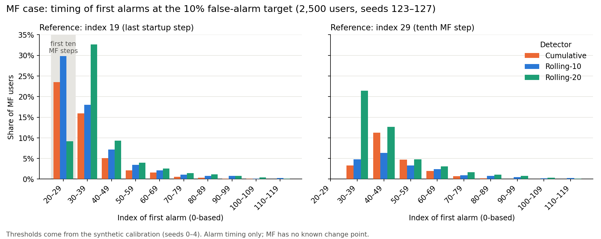
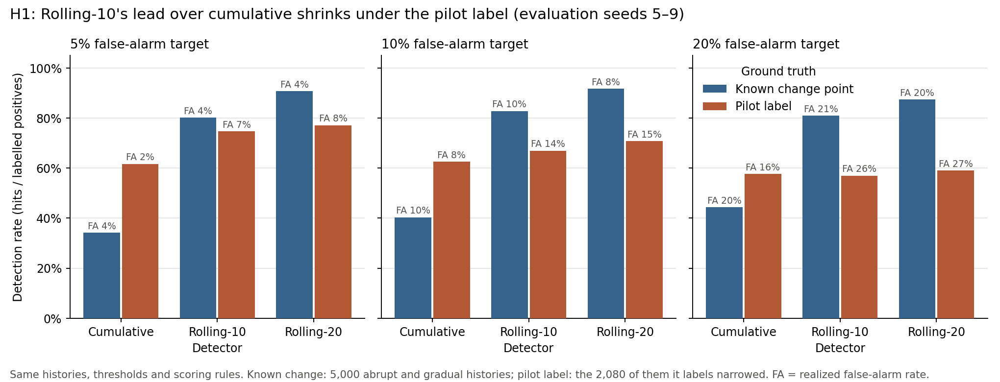
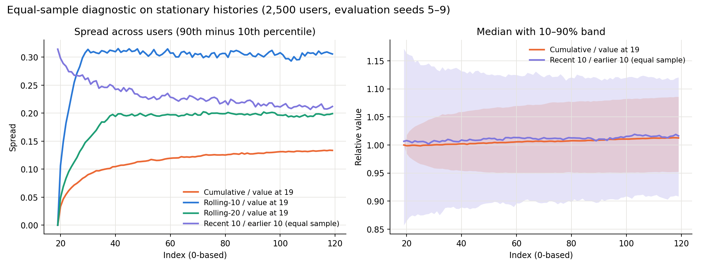

# MF case, H1 label check and equal-sample diagnostic

This note covers the second analysis stage: the matrix-factorization (MF) application case, the H1 check with the pilot's label, the equal-sample diagnostic, and the JSON export for the visualization. Definitions follow [docs/spec.md](spec.md). All indices are 0-based.

These settings are still marked **Proposed** in the spec, and the results depend on them:

- The candidate MF configuration and the twenty-step narrowing diagnostic.
- MF uses one seed (123).
- MF thresholds taken from the synthetic calibration.
- The definition of the recent-versus-early ratio.

Treat the results as provisional until both members confirm these settings.

## 1. MF application case

**Status.** The MF results first reported here used the original configuration in spec §7. That configuration stopped working as a recommender in the second half of the run, so its histories carried no useful signal about narrowing. Its results are superseded and kept in §1.3 only as a record.

The current MF data use the candidate configuration from [docs/mf_pipeline_experiment.md](mf_pipeline_experiment.md), which is still **Proposed**. MF is a qualitative application, so it uses one seed (123); see spec §7. The percentages in §1.2 describe that seed only. The qualitative pattern, narrowing episodes that all end before the final 20 steps, also appeared in development seeds 128 and 133.

### 1.1 Why the original configuration was replaced

Recommendation quality is the mean inner product of actual preferences and item attributes. It is averaged over a fixed cohort of ten users (cohort seed 130) and the last ten MF steps. A Random slate draws ten items uniformly from the same user's eligible pool. The numbers come from `scripts/run_mf_experiment.py` on development seeds:

| Seed | Original: MF slate / Random slate | Candidate: MF slate / Random slate |
|---|---:|---:|
| 128 | 0.0314 / 0.0487 | 0.0611 / 0.0477 |
| 133 | 0.0360 / 0.0486 | 0.0641 / 0.0475 |

Each run has its own Random comparison, because users' eligible pools depend on what they consumed earlier.

Late in the run, the original MF ranked items worse than Random. The candidate ranks above Random at all 100 MF steps in both seeds. [docs/mf_pipeline_experiment.md](mf_pipeline_experiment.md) records the controls that led to the candidate.

### 1.2 Candidate configuration, seed 123

**Recommendation quality.** Averaged over the cohort, the candidate's ranked slate beat a Random slate at all 100 MF steps. Nine of the ten cohort users beat Random on average over the last ten steps. Over the last ten steps, the item users actually chose scored 0.0874, against 0.0793 for the expected best item of a Random slate.

**Twenty-step narrowing diagnostic** (spec §7, Proposed):

| Count | Users of 500 |
|---|---:|
| Any 20 consecutive MF steps within one or two topics | 140 |
| Of those, within the user's own two favorite topics | 85 |
| Within one or two topics over the final 20 steps | 0 |

Narrowing episodes occur, but none lasts to the end of the run.

**Alarms at the 10% target, 500 users:**

| Detector | Alarmed, `startup` reference | Of which in the first ten MF steps (indices 20–29) | Alarmed, `early_mf` reference |
|---|---:|---:|---:|
| Cumulative | 90% | 38% of all users | 69% |
| Rolling-10 | 93% | 46% | 33% |
| Rolling-20 | 94% | 14% | 84% |

As before, alarms in the first ten MF steps are a description of timing. They do not show that the switch to MF caused them. The two references keep the limitations in spec §7.

**Detector disagreement** (`startup` reference, 10% target):

- Rolling-10 alarms on 33 users where Cumulative does not; the reverse happens for 16 users.
- Rolling-10 and Rolling-20 disagree on 31 users.

**Working hypothesis: why episodes end.** The episodes are taken to be real narrowing that ends when the narrowed topics run out of items the user would choose. Nothing is consumed twice and the catalog is fixed at 2,000 items, so such items deplete. Two development observations in [docs/mf_pipeline_experiment.md](mf_pipeline_experiment.md) bear on this, and neither settles it:

- At 874 of 893 first departures from a ten-step episode (seeds 128 and 133), the pool still held an item from the same topic group with higher actual utility than the item chosen, but it was not on the slate. Departures therefore involve what the slate shows as well as depletion.
- When ten new items arrived per step and the two random slots showed only new arrivals, 1 of 500 users stayed within one or two topics for the final 20 steps. The ranked MF slots could not show new items, which score zero until they are consumed, so this is not a clean test of the hypothesis.

A test is still to be designed and its result recorded here.

Files: `results/mf_candidate/summary.json` and `results/mf_candidate/candidate/mf_seed123.npz` (not committed).

### 1.3 Original configuration (superseded)

These results describe histories from a model that, late in the run, recommended worse than Random. They are kept for the record and are not results about narrowing.

**Setup (original configuration).**

- 5 seeds (123–127), each with 500 users and 2,000 items.
- `CheckedImplicitMF` with 10 latent factors, 20 ALS iterations and slates of 10.
- 20 random startup steps, then 100 MF steps with a refit after every step.
- Fixed preferences and no repeated consumption.

The simulation loop matches `scripts/audit_behavior.py`. Thresholds come from the synthetic calibration (seeds 0–4). They are not recalibrated on MF histories.

There are two references:

- `startup`: the value at index 19, with alarms from index 20.
- `early_mf`: the value at index 29, with alarms from index 30.

MF has no known change point, so these results describe **alarm timing and detector disagreement only**. They do not make hit-rate claims.

**Results at the 10% target, 2,500 users pooled.** The range in brackets is over the five seeds.

| Detector | Alarmed, `startup` reference | Of which in the first ten MF steps (indices 20–29) | Alarmed, `early_mf` reference |
|---|---:|---:|---:|
| Cumulative | 49% (45–52%) | 24% of all users (18–26%) | 22% (17–28%) |
| Rolling-10 | 64% (59–67%) | 30% (25–34%) | 19% (18–22%) |
| Rolling-20 | 62% (58–64%) | 9% (6–11%) | 46% (40–49%) |



**`startup` reference.** Under this reference, a large share of first alarms occur in the first ten MF steps. This is a description of timing; it does not show that the switch to MF caused these alarms. Rolling-20 alarms later, mostly at indices 30–39, because its 20-item window still holds startup items until index 39.

**`early_mf` reference.** Under this reference, alarm counts fall for all detectors. Rolling-20 keeps the most alarms. Its reference window, indices 10–29, still includes ten startup items, so its baseline stays high. Cumulative's reference also includes startup items. Both limitations should be stated wherever this reference is reported.

**Detector disagreement** (`startup` reference, 10% target, 2,500 users):

- Rolling-10 alarms on 453 users where Cumulative does not; the reverse happens for 99 users.
- Rolling-10 and Rolling-20 disagree on 389 users.

These users are the material for the matrix view.

Files:

- `results/mf/mf_alarm_summary.csv` (pooled)
- `results/mf/mf_alarm_summary_by_seed.csv`
- `results/mf/mf_alarm_timing.csv`
- `results/mf/mf_detector_disagreement.csv`

## 2. H1: rescoring with the pilot label

**Method.** The same 7,500 evaluation histories (seeds 5–9, three scenarios) are scored twice. Both runs use the same calibrated thresholds and the scoring rules in spec §5.

- **Known change point**: positives are the 5,000 abrupt and gradual histories, scored against `t_star`. Negatives are the stationary histories.
- **Pilot label**: the label from the October pilot, computed from the consumed items.
  - The base is the diversity at indices 0–19.
  - s(*t*) is the diversity of the centred 10-item window *t*−5..*t*+4.
  - A history is labelled *narrowed* when s(*t*) < 0.7 × base for 10 consecutive indices from index 20 on. The onset is the first of those indices.
  - It is labelled *stable* when s(*t*) never stays below 0.85 × base for 10 indices.
  - Every other history is *ambiguous* and excluded.
  - Positives are the narrowed abrupt and gradual histories. Negatives are all histories labelled stable, whatever their scenario.

**How the pilot label sees the histories:**

| True scenario | Labelled narrowed | Labelled stable | Ambiguous | Median label onset − `t_star` |
|---|---:|---:|---:|---:|
| Stationary | 0 | 2,408 | 92 | — |
| Abrupt | 1,137 | 174 | 1,189 | +4 |
| Gradual | 943 | 253 | 1,304 | +18 |

**Detection rate, abrupt and gradual together, at the 10% target:**

| Detector | Known change point (realized false-alarm rate) | Pilot label (realized false-alarm rate) |
|---|---:|---:|
| Cumulative | 40.3% (10.5%) | 62.6% (7.6%) |
| Rolling-10 | 82.8% (10.5%) | 67.0% (13.9%) |
| Rolling-20 | 91.7% (8.1%) | 70.8% (14.9%) |



**Finding.** H1 expected Rolling-10's lead over Cumulative to be *larger* under the pilot label. It is *smaller* at every target. The lead and its range over seeds:

| Target | Known change point | Pilot label |
|---|---|---|
| 5% | +46.0 points (42.6 to 50.1) | +13.1 (8.1 to 16.1) |
| 10% | +42.5 (39.8 to 45.6) | +4.4 (2.2 to 6.8) |
| 20% | +36.7 (34.0 to 38.0) | −0.7 (−2.8 to 2.9) |

So, under the fixed scoring rules, the pilot label does not favour Rolling-10.

Two features of the label work against fast detectors:

- Its onset comes after `t_star`, so alarms that are early relative to the label count as early false alarms and misses. At the 10% target, Rolling-10 has 687 such early alarms, against 382 for Cumulative.
- It keeps only the strongest narrowings as positives, and those are easier for Cumulative.

The pilot itself also counted alarms up to five steps before its onset as hits, with no upper limit. That looser rule may explain part of its Rolling-10 advantage. We did not rescore with it, because the spec fixes the scoring rules.

Files:

- `results/synthetic/alternate_label_results.csv`
- `results/synthetic/alternate_label_results_by_seed.csv`
- `results/synthetic/alternate_label_agreement.csv`

## 3. Equal-sample diagnostic

**Method.** On the 2,500 stationary evaluation histories, each measure is divided by its own value at index 19; this ratio is what the alarm thresholds act on.

The recent-versus-early ratio is computed differently. It compares the diversity of the last 10 items with the average diversity of 10 items drawn without replacement from the earlier history (20 draws). Both sides of the ratio therefore always hold 10 items.

The plan's question was this: if Cumulative's spread across users *shrinks* over time while the equal-sample ratio's spread stays flat, is Cumulative's stability a sampling effect?

**Spread across users (90th minus 10th percentile):**

| Measure | Index 30 | Index 60 | Index 119 |
|---|---:|---:|---:|
| Cumulative / value at 19 | 0.090 | 0.119 | 0.133 |
| Rolling-10 / value at 19 | 0.314 | 0.307 | 0.306 |
| Rolling-20 / value at 19 | 0.153 | 0.197 | 0.199 |
| Recent 10 / earlier 10 | 0.263 | 0.228 | 0.212 |



**Finding.** Cumulative's relative spread does not shrink. It grows slowly, from 0.09 to 0.13, and stays the narrowest of all four measures at every index.

The narrow spread comes from overlap, not from a sample size that grows over time: each cumulative value still contains the 20 reference items. Because of this, a stationary user's cumulative value rarely moves far from its reference. This is why calibration gives Cumulative the smallest thresholds (θ = 0.065 at the 10% target). A real narrowing must then outweigh all earlier items before it shows.

The equal-sample ratio's spread narrows somewhat over time, from 0.26 to 0.21. Its early side averages over a growing pool, which makes it less noisy.

## 4. Visualization data

`scripts/export_vis_data.py` writes the following files to `data/`. They are ignored by Git; the 5-user samples in `data/sample/` are committed.

- `summary.json`: 18 rows, the synthetic results table.
- `synthetic.json`: evaluation seed 5, 1,500 records, 5.9 MB.
- `mf.json`: MF seed 123 from the candidate configuration, 500 records with both references, 2.1 MB. Export it with `--mf-dir results/mf_candidate/candidate`.

Each record also holds `series.recent_vs_early`.

Values are rounded to 4 decimals. Alarms are computed before rounding, so recomputing an alarm from the rounded values can differ when a value lies within rounding error of the limit.

`scripts/check_export.py` checks the following:

- the schema in spec §8;
- recomputed alarms, with tolerance for rounding;
- that the exported alarms for seed 5 reproduce every hit, early-alarm and false-alarm count in `synthetic_alarm_results_by_seed.csv`.

## Reproduce

Use the pinned environment in `README.md`, from the repository root:

```sh
python scripts/check_metrics.py
python scripts/check_mf_experiment.py
python scripts/run_mf_experiment.py --seeds 123 --policies candidate --output-dir results/mf_candidate   # about 1 minute
python scripts/run_mf_case.py                 # original configuration, §1.3 only; reuses results/mf/*.npz
python scripts/evaluate_alternate_labels.py   # about 1 minute
python scripts/equal_sample_diagnostic.py     # about 1 minute
python scripts/export_vis_data.py --mf-dir results/mf_candidate/candidate
python scripts/check_export.py
python scripts/plot_mf_alarm_timing.py
python scripts/plot_alternate_labels.py
python scripts/plot_equal_sample.py
```

Seeds:

| Seed | Use |
|---|---|
| 0–4 | Calibration, via the existing thresholds |
| 5–9 | Evaluation |
| 123 | MF, candidate configuration |
| 123–127 | MF, original configuration (§1.3 only) |
| 128, 130, 133, 134 | Development of the candidate MF configuration (see spec §6) |
| `[seed, 2]` | Random stream for the recent-versus-early ratio in the export |
| `[seed, 3]` | Random stream for the recent-versus-early ratio in the diagnostic |
