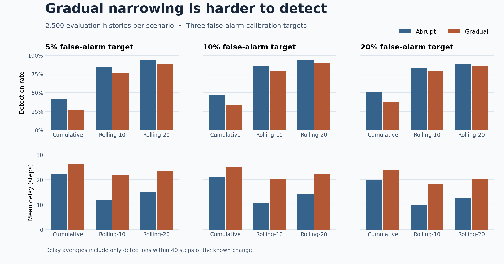

# Synthetic experiment findings for RQ1 and RQ2

Each of 10 seeds generated 500 simulated users with stationary, abrupt, and gradual histories. Stationary histories from seeds 0–4 calibrated the thresholds. Seeds 5–9 supplied 2,500 held-out histories per scenario. The results below are for the synthetic experiment with narrowing to two topics.

## RQ1. How do the three windows compare?

The table uses the 10% calibration target as an example. The false-alarm column reports the actual rate on held-out stationary histories. Mean delay is measured among each detector's timely hits.

| Detector | Actual false-alarm rate | Abrupt detection rate | Abrupt mean delay | Gradual detection rate | Gradual mean delay |
|---|---:|---:|---:|---:|---:|
| Cumulative | 10.48% | 47.32% | 21.09 steps | 33.32% | 25.24 steps |
| Rolling-10 | 10.48% | 86.36% | 10.85 steps | 79.28% | 20.09 steps |
| Rolling-20 | 8.08% | 93.40% | 14.16 steps | 90.04% | 22.14 steps |

In the pooled results at all three calibration targets, Rolling-20 detected the most histories, while Rolling-10 had the shortest mean delay among its own timely hits. Actual false-alarm rates vary by detector and target, so read them alongside the detection rates and delays.

## RQ2. Does abrupt narrowing differ from gradual narrowing?

Across all nine detector–target comparisons in the pooled results, gradual narrowing had fewer timely hits and longer mean delays. At the 10% target, Rolling-10 detection fell from 86.36% to 79.28% and mean delay rose from 10.85 to 20.09 steps.

[Aggregate results](../results/synthetic/synthetic_alarm_results.csv) · [Per-seed results](../results/synthetic/synthetic_alarm_results_by_seed.csv) · [Experiment design, example figures, and reproduction commands](synthetic_experiment.md)
