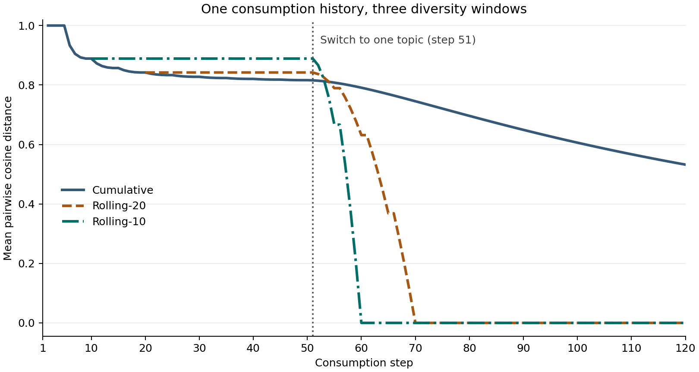
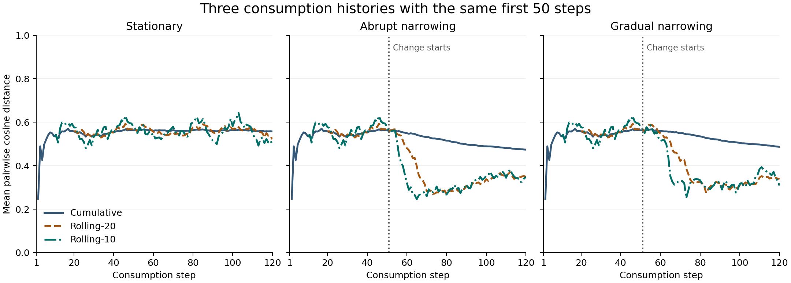

# Synthetic narrowing experiment

This run supplies the synthetic results for RQ1 (detection rate, false-alarm rate, and delay across windows) and RQ2 (abrupt versus gradual narrowing).

## Design

Each of ten seeds generates 500 simulated users and three paired 120-step histories per user. The stationary scenario keeps the candidate pool unrestricted. The abrupt and gradual scenarios restrict the pool to the user's top two topics immediately or over 30 steps, respectively. The three histories share the same user preferences, item pool, and pre-change consumption.

Seeds 0–4 supply 2,500 stationary calibration histories. Seeds 5–9 supply 2,500 held-out histories per scenario. We use cumulative, rolling-10, and rolling-20 diversity from the shared metrics module. Each series uses its score at step 20 as a reference. Starting at step 21, three consecutive scores strictly below the threshold trigger an alarm on the third step.

For each detector and target false-alarm rate (5%, 10%, 20%), calibration chooses the smallest relative drop threshold on a 0.001 grid whose stationary false-alarm rate does not exceed the target. A stationary user counts once if any alarm occurs. For a narrowing history, the first alarm counts as a hit if its index falls from the known change index through that index plus 39, inclusive. An early first alarm counts as an early false alarm and a miss. Mean delay includes timely hits only.

## Example histories



The first example uses a hand-built consumption history. The first 50 items alternate among five topics and the remaining items share one topic. It illustrates how the three windows respond to the same known change.

### Three synthetic scenarios



This development example shows one user across three scenarios with identical first 50 steps. The two narrowing scenarios restrict candidates to one topic in this example. The aggregate RQ1 and RQ2 evaluation uses two topics.

## Reproduce

Use the repository's pinned Python environment and the shared `src/metrics.py` from the diversity-metrics branch.

```sh
python scripts/calibrate_synthetic_alarms.py
python scripts/one_user_cosine_diversity.py
python scripts/plot_rq2.py
python scripts/plot_synthetic_scenario_example.py
```

The first command generates all histories, calibrates on the stationary subset, evaluates the held-out seeds, and writes two tables under `results/synthetic/`. The RQ2 script reads the aggregate table. The other two scripts recreate their example histories. All three scripts write figures in the same directory. To generate a single batch for inspection:

```sh
python scripts/generate_synthetic_batch.py src/metrics.py --seed 101 --users 30 --top-k 2 --output results/synthetic/batch_sample.npz
```

## Result files

See the [RQ1 and RQ2 findings](rq1_rq2_findings.md) for a summary and the RQ2 comparison figure.

- `synthetic_alarm_results.csv` contains aggregate results. Divide `hits` by `users` for detection rate. Each row also reports the calibrated threshold, realized false-alarm rate, and mean delay.
- `synthetic_alarm_results_by_seed.csv` reports the same measures separately for each evaluation seed. Stationary false-alarm rates are repeated across the two narrowing rows for a detector and target.
- `rq2_abrupt_vs_gradual.png` shows both narrowing scenarios at all three calibration targets. Gradual narrowing had a lower detection rate and higher mean delay in all nine aggregate detector–target comparisons.

The realized evaluation false-alarm rate varies by detector. Report it alongside hit rates and delays. The MF application case, alternate-label comparison, and linked visualization remain future work.
